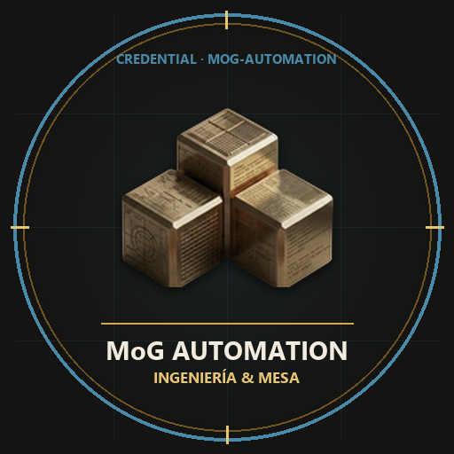
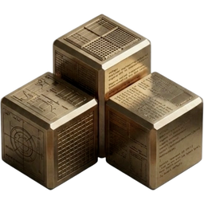

  

# 🔸 MoG AUTOMATION (`mogautomation-arch`) · Ingeniería, Automatización y MESA · MoG CORPORATION

**Identidad de Cuenta GitHub:** [`mogautomation-arch`](https://github.com/mogautomation-arch) (`credential_group: mog-automation`)  
**Organización Rectora:** [`mog-corporation`](https://github.com/mog-corporation) (**MoG CORPORATION** · **01 - Eco-Logics Control Clima S.L.** · **02 - Ingeteyco S.L.** · **Inversiones MoG S.L.**)  
**Autoridad Soberana:** D. Miguel Ortega (`🔶 MoG CEo & ARQ`) — [`mortega-spec`](https://github.com/mortega-spec)

---

## 1. Rol Contractual y Segregación `writer != verifier != merger`
- **`mogautomation-arch`** actúa como cuenta de **escritura, empuje de ramas (`pusher`), automatización CI y sincronización MESA** dentro del grupo de credencial `mog-automation`.
- **Segregación Inmutable:** conforme a la Regla de Organización vigente, `mogautomation-arch` **nunca firma su propio conforme** ni aprueba código producido por su propio grupo. La verificación independiente corresponde a **`mog-verificador`** (`credential_group: mog-verificador`) sobre el `HEAD` exacto de 40 caracteres.
- **Fusión Centralizada por Gates:** toda promoción a `main` exige `mide_resenas.py = LISTO` (`exit 0`), checks requeridos en verde, cero hilos abiertos, ausencia de etiqueta `HOLD`, cero hallazgos de seguridad pendientes y readback `merged=true`.

## 2. Arquitectura de Repositorios Gobernados (`9/9` Org + Control Plane Comms)

| Repositorio | Función en el Stack **MoG CORPORATION** |
|---|---|
| `mog-corporation/mog-universe` | Fuente canónica de reglas, `CODIGO_CANON`, skills federadas y perfiles |
| `mog-corporation/mog-suite` | Frente de **13 APPS** y **5 Sedes de Superadmin** bajo «El Norte» (`ds-norte.css`) |
| `mog-corporation/mog-containers-m1` | Contenedores operativos simétricos (`WIP=1`, aislamiento estricto sin secretos) |
| `mog-corporation/mog-federation` | Capa federativa por empresa, departamento y cargo del grupo |
| `mog-corporation/mog-control-plane` | Servicio Cloud Run `mog-control-plane` y plano de control autenticado |
| `mog-corporation/mogbot-personal-skills` | Skills privadas de dirección ejecutiva y patrimonio |
| `mog-corporation/mogautomation-arch` | Motores de mantenimiento multi-repo, vigías Nivel 0 (`0,00 €`) y auto-merge |
| `mog-corporation/mog-data-engine` | Motor de datos gobernado, trazabilidad y cuadre |
| `mog-corporation/.github` | Perfil oficial de organización, activos públicos R1 y workflows reutilizables |
| `mogautomation-arch/mog-comms-gateway` | Control plane de eventos, relays durables y leases de coordinación |

## 3. Estándares de Ingeniería, Calidad Visual y Coste (`Nivel 0 · 0,00 €`)
- **Design System «El Norte»:** jerarquía visual `Space Grotesk` / `DM Serif Display` / `Space Mono`, tokens `ds-norte.css`, Estado Vacío Noble y contrato `window.__MOG_AX__`.
- **Topología Multi-Nodo Federada:** operación coordinada en estaciones M1, M2 y M3 comunicadas mediante el Puente Local Loopback (`< 5 ms`, `0,00 €`), Bus duradero de sobres y tablero HMI vivo en `mog-universe#269`.
- **Cero secretos o IPs privadas en repositorios públicos:** auditoría continua con `gitleaks` y validación `L8` (`0` literales de veredicto sin verificación independiente).

---

   
  <strong>🔸 MoGbot Antigravity · Ejecutor de front y preview IA · MoG CORPORATION</strong>

